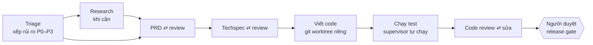

# workflow-coding

Điều phối ba AI coding CLI (Codex, Claude Code, Antigravity) làm việc như một đội
phần mềm nhỏ: nhận yêu cầu, viết PRD, techspec, viết code, chạy test, review chéo,
rồi dừng chờ người duyệt. Mỗi vai do một persona đảm nhiệm (product manager,
senior dev, reviewer...). Người viết và người review luôn chạy trên **hai CLI khác
nhau**. Flow không bao giờ tự merge, push hay deploy.



Có hai lệnh:

| Lệnh | Dùng khi |
| --- | --- |
| `run_flow.py` | Làm một việc từ yêu cầu đến nhánh code chờ duyệt (luồng chính) |
| `run_lab.py` | Chỉ cần nghiên cứu một câu hỏi trên bộ nguồn bạn cung cấp |

## Cài đặt

Cần Linux, Python 3.13, git, và ba CLI đã cài và đăng nhập sẵn: `codex`, `claude`, `agy`.

```bash
git clone https://github.com/hoanghuydev/workflow-coding.git && cd workflow-coding
python3 -m venv .venv
.venv/bin/python -m pip install -r requirements.lock.txt
cp config/agents.example.json config/agents.local.json
# Sửa config/agents.local.json: đường dẫn tuyệt đối tới từng CLI (`which codex`),
# model ID và effort mà tài khoản của bạn dùng được.

.venv/bin/python run_flow.py start --demo --auto-approve   # chạy thử offline, không tốn quota
.venv/bin/python run_lab.py --check                        # kiểm cấu hình và version CLI, không gọi model
.venv/bin/python -m unittest discover -s tests             # test offline
```

`--demo` dùng CLI giả lập và một repo mẫu, nên chỉ chứng minh luồng chạy đúng,
không chứng minh login, quota hay model thật.

## Dùng qua AI (khuyến nghị)

Mở repo này bằng Claude Code, Codex hoặc Antigravity rồi nói việc bạn cần. AI đọc
`AGENTS.md` (Claude Code đọc qua `CLAUDE.md`), nên biết cách vận hành flow thay bạn:

1. Hỏi những gì nó không tự tìm được: repo đích, nhánh gốc, lệnh test, mức rủi ro.
2. Viết yêu cầu vào `requests/<ngày>-<tên>.md`, đưa bạn xem, rồi mới `start`.
3. Khi flow dừng ở một cổng duyệt: đọc tài liệu, finding, kết quả test và diff, tóm
   tắt lại cho bạn, rồi hỏi bạn quyết định.
4. Chuyển câu trả lời của bạn thành lệnh `approve`/`revise`/`reject`. AI không tự duyệt
   thay bạn, không merge, không push.
5. Khi xong: tóm tắt `report.md`, chỉ nhánh code và lệnh để bạn tự review, merge.

Ví dụ:

> **Bạn:** Thêm bộ lọc theo trạng thái cho trang /transactions trong repo ~/code/cpay
>
> **AI:** Tôi đề xuất mức rủi ro P2, lệnh test `go test ./...`. Đây là yêu cầu tôi
> viết (...). Chạy nhé?
>
> **Bạn:** Chạy đi
>
> **AI:** Flow đang dừng ở cổng techspec (đã dùng 5/40 lượt gọi). Techspec sửa 3 file,
> không đổi schema. CTO còn 1 finding major: chưa xử lý trạng thái rỗng. Bạn muốn
> duyệt hay yêu cầu sửa?

Quay lại sau nhiều ngày: hỏi AI "đang có task nào?". AI sẽ chạy `run_flow.py list`.
Phần dưới là các lệnh mà AI chạy; bạn cũng có thể tự gõ.

## Dùng work flow

### 1. Viết yêu cầu

Một file Markdown mô tả việc cần làm, như khi giao cho một developer:

```markdown
# Lọc giao dịch theo trạng thái

Merchant cần lọc danh sách giao dịch theo trạng thái (thành công / chờ / lỗi)
trên trang /transactions. Dùng endpoint list hiện có. Không đổi schema DB.
```

### 2. Bắt đầu task

```bash
.venv/bin/python run_flow.py start --request yeu-cau.md \
  --repo ~/code/cpay --base main --test "go test ./..." --risk P2
```

| Tham số | Ý nghĩa |
| --- | --- |
| `--repo`, `--base` | Repo đích và nhánh gốc. Agent làm trong worktree mới, nhánh `flow/<task-id>`; repo gốc không bị đụng |
| `--test` | Lệnh test mà supervisor tự chạy sau mỗi vòng code. Đây là bằng chứng duy nhất được tin; lời model nói "test đã đạt" thì không |
| `--risk` | Mức rủi ro tối thiểu (mặc định P1). Triage chỉ được nâng, không được hạ |
| `--brief` | (Tùy chọn) bộ nguồn để chạy research trước khi viết PRD |
| `--rules` | (Tùy chọn, lặp được) file rule thêm trong repo đích, ví dụ `docs/quy-uoc.md` |
| `--skill` | (Tùy chọn, lặp được) skill cho task này, lấy từ repo dự án hoặc skill chung |
| `--max-calls` | Giới hạn số lượt gọi model của task (mặc định 40) |

Mức rủi ro quyết định số bước và số người review:

| Rủi ro | Ví dụ | PRD + techspec | Người duyệt dừng ở | Reviewer code |
| --- | --- | --- | --- | --- |
| P0 | tiền, idempotency, phân quyền | có | PRD, techspec, release | 3 |
| P1 | deploy, migration, tích hợp | có | PRD, techspec, release | 2 |
| P2 | danh sách, bộ lọc, dashboard | có | techspec, release | 1 |
| P3 | demo, thử nghiệm | không | release | 1 |

### 3. Trả lời khi flow dừng chờ bạn

Lệnh `start` chạy đến cổng duyệt đầu tiên rồi dừng (exit code `2`) và in ra file
cần đọc, ví dụ `tasks/<task-id>/gates/techspec-r1.md`. File đó tóm tắt tài liệu,
các finding còn mở và in sẵn lệnh trả lời:

```bash
.venv/bin/python run_flow.py list                                    # mọi task và việc đang chờ
.venv/bin/python run_flow.py status  <task-id>                       # đang ở đâu, chờ gì
.venv/bin/python run_flow.py approve <task-id> [--note "..."]        # đồng ý, đi tiếp
.venv/bin/python run_flow.py revise  <task-id> --note "Thiếu case trạng thái rỗng"
.venv/bin/python run_flow.py reject  <task-id> --note "Không làm nữa"
.venv/bin/python run_flow.py approve <task-id> --risk P0             # đổi mức rủi ro từ đây trở đi
```

`revise` gửi bước đó lại cho AI. Note của bạn thành một yêu cầu bắt buộc mà vòng
sau phải xử lý và giải trình. Task có thể chờ bao lâu cũng được: trạng thái nằm
trong `tasks/<task-id>/`.

Các cổng đặc biệt:

| Cổng | Khi nào | Trả lời |
| --- | --- | --- |
| `research` | Triage thấy cần thông tin bên ngoài mà repo không có | `research <id> --brief nguon.md`, hoặc `approve` để bỏ qua |
| `blocked` | Một lượt gọi AI lỗi, timeout, hoặc hết `--max-calls` | Xem log trong `tasks/<id>/jobs/`, rồi `retry <id> [--max-calls 60]` hoặc `reject` |

Flow không tự retry. Nếu máy tắt hay bạn bấm Ctrl-C, chạy
`run_flow.py resume <task-id>`: lượt gọi đã xong được dùng lại, không tốn quota lần hai.

### 4. Nhận kết quả

Sau khi bạn `approve` ở release gate:

- Code nằm ở nhánh `flow/<task-id>` trong repo đích, mỗi vòng một commit có trailer
  `Flow-Persona`, `Flow-Runtime`. Bạn tự review diff rồi merge như bình thường.
- `tasks/<task-id>/docs/prd.md`, `docs/techspec.md`: tài liệu cuối.
- `tasks/<task-id>/report.md`: tóm tắt quyết định và số lượt gọi.
- Dọn worktree: `git -C ~/code/cpay worktree remove <đường dẫn tasks/<id>/worktree>`.

## Dùng research riêng

```bash
.venv/bin/python run_lab.py --brief path/brief.md --timeout 900
```

Brief gồm câu hỏi và các mục `Source S01`, `Source S02`... chứa nguyên văn nguồn.
Ba AI nghiên cứu độc lập, audit chéo, phản biện, rồi xuất `runs/<run-id>/final-report.md`
với các kết luận được chia thành verified, disputed và inconclusive. Mẫu:
[inputs/brief.md](inputs/brief.md). Chi tiết: [docs/research.md](docs/research.md).

## Tùy chỉnh

| File | Chứa gì |
| --- | --- |
| `config/agents.local.json` | Đường dẫn CLI, model và effort mặc định của máy bạn (không commit) |
| `config/personas.json` | Persona: runtime, model/effort riêng, vai trò, tư duy, khi nào phải hỏi người |
| `config/flow.json` | Ai làm gì ở mức rủi ro nào, cổng duyệt, giới hạn vòng sửa, số lượt gọi |
| `protocols/flow/*.md` | Hướng dẫn cho từng bước (triage, PRD, techspec, implement, review, QA) |
| `protocols/*.md`, `config/review-rubric.md` | Hướng dẫn cho research |
| `rules/*.md` | Rule code chung cho mọi dự án |

### Rule và skill

| Loại | Đặt ở đâu | Áp dụng |
| --- | --- | --- |
| Rule chung | `rules/*.md` trong repo này | mọi task |
| Rule dự án | `AGENTS.md`, `CLAUDE.md` ở gốc repo dự án (tự đọc); file khác thì dùng `--rules <đường dẫn trong repo>` | task trên repo đó |
| Skill chung | `.agents/skills/<tên>/` trong repo này, hash ghi trong `config/skills.lock.json` | bước được gán trong `config/flow.json` → `skills`, hoặc một task qua `--skill <tên>` |
| Skill dự án | `.agents/skills/<tên>/` hoặc `.claude/skills/<tên>/` trong repo dự án | task chọn nó bằng `--skill <tên>` |

- **Rule là quy định bắt buộc.** Mọi bước nhận nguyên văn rule, và reviewer kiểm theo rule.
- **Skill là kiến thức tham khảo,** xếp sau rule.
- **Skill phải chọn theo task,** vì mỗi skill được chọn tốn token ở mọi lượt gọi của các bước có code.
- **Script trong `scripts/` của một skill dự án** chỉ bước viết code được chạy, và chỉ đúng
  lệnh flow liệt kê. Kết quả cần làm bằng chứng thì đưa script vào `--test`, để supervisor tự chạy.
- **Rule và skill dự án được đọc từ commit gốc,** nên phải commit chúng trước khi start.
- **Rule và skill trong `~/.claude/`, `~/.codex/`** chỉ áp dụng cho AI bạn đang chat, không tới AI con.

Chi tiết xem [docs/flow.md](docs/flow.md#rule).

Khi nạp cấu hình, flow tự kiểm tra và từ chối nếu reviewer chạy cùng CLI với tác
giả, nếu Antigravity được giao viết code (chế độ ghi của nó chưa được kiểm chứng),
hoặc nếu một mức rủi ro thiếu release gate. Mỗi task khóa (seal) cấu hình lúc
tạo, nên sửa config không ảnh hưởng task đang chạy.

## Lưu ý an toàn

- Lệnh test chạy code do AI viết ngay trên máy bạn. Quyền của CLI chưa phải cách
  ly hệ điều hành: Codex có sandbox, còn Claude Code chỉ bị giới hạn bằng
  allowlist công cụ. Đừng chạy trên máy có secret production.
- `--max-calls` và `--timeout` giới hạn số lượt gọi và thời gian, không phải tiền.
- AI review không thay được người review. Release gate tồn tại để bạn đọc diff.
- Không commit `config/agents.local.json`, `tasks/`, `runs/`, `requests/`, `.venv/`.

## Tài liệu

- [AGENTS.md](AGENTS.md): quy tắc cho AI khi vận hành flow hoặc sửa repo này
- [docs/flow.md](docs/flow.md): kiến trúc work flow, bất biến, quyền theo chế độ, cấu trúc thư mục task
- [docs/research.md](docs/research.md): research pipeline, resume, artifact, thêm skill
