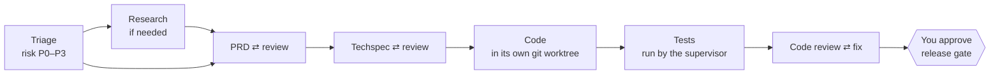

# workflow-coding

**Turn three AI coding CLIs into a small software team that plans, builds, tests and
cross-reviews your change, then waits for your sign-off.**

You describe the work in plain words. workflow-coding takes it through the steps a
careful team would follow: triage, a product spec, a technical spec, code, tests and code
review. Codex, Claude Code and Antigravity each play defined roles, and the AI that
reviews a piece of work always runs on a different CLI from the AI that wrote it. At every
decision point the flow stops and asks you. Nothing is merged, pushed or deployed for you.

```text
You ask:   "Add a status filter to the /transactions page in ~/code/cpay"
The flow:  triage → PRD → techspec → code → tests → cross-review → waits for you
You get:   branch flow/<task-id>, the specs behind it, and a report of every decision
```

## Why workflow-coding

Asking one AI agent to "just build it" works until it doesn't. These are the usual ways
it goes wrong, and what this project does about each:

| The problem | What workflow-coding does |
| --- | --- |
| The agent grades its own homework | Writer and reviewer always run on different CLIs from different vendors. The flow refuses any config that breaks this |
| "All tests pass" is a sentence the model wrote | The supervisor runs your test command itself after every code round. Only that result counts as test evidence |
| A typo fix and a payment change get the same process | Every task gets a risk tier, P0 to P3. Higher tiers add specs, approval gates and reviewers |
| The AI decides when it's done | Code decides the next step from open findings, test results and round limits. A model's verdict never routes the flow |
| Changes land without a human look | Agents work in a separate git worktree on their own branch. Every task ends at a release gate, and merging stays with you |
| Long runs burn quota, and a crash burns it twice | Each task has a model call limit. Finished calls are recorded and reused on resume, never paid for again |
| Nobody remembers why the code looks this way | Each task keeps its PRD, techspec, review findings, your gate decisions and the test logs |

## What you can use it for

- **Features and bug fixes** (`--kind code`, the default). PRD → techspec → code → tests →
  review. For a bug, the PRD records current and expected behaviour and turns the
  reproduction steps into a failing acceptance criterion; the techspec has to name the
  root cause.
- **UI and UX work** (`--kind design`). Adds a UX spec that always stops for your approval,
  and a UI reviewer on the code.
- **Technical docs and API references** (`--kind docs`). A technical writer drafts, a docs
  verifier checks the result against the code.
- **Homepage and marketing copy** (`--kind content`). A copywriter drafts, a content editor
  checks it.
- **Research questions** (`run_lab.py`). Three AIs research independently over sources you
  supply, audit each other's claims against those sources, and sort the findings into
  verified, disputed and inconclusive.

## Meet the team

Fourteen personas, each with its own runtime, model, effort level and instructions in
`config/personas.json`. You never pick one: the kind of work and the risk tier do.

| Job | Persona | Runs on |
| --- | --- | --- |
| Sizes up the request and its risk | triage-lead | Codex |
| Writes the PRD | product-manager | Codex |
| Reviews the PRD | requirements-reviewer | Claude Code |
| Writes the techspec and the code | engineer | Codex |
| Reviews the techspec | architecture-reviewer | Claude Code |
| Reviews the code | code-reviewer | Claude Code |
| Checks money, state and permission invariants (P0) | critical-invariants-reviewer | Claude Code |
| Hunts for failure cases the tests missed (P0, P1) | adversarial-qa | Antigravity |
| Specifies the UX (`design`) | ux-designer | Codex |
| Reviews the UX spec and the UI code (`design`) | ui-reviewer | Claude Code |
| Writes and checks docs (`docs`) | technical-writer, docs-verifier | Codex, Claude Code |
| Writes and edits copy (`content`) | copywriter, content-editor | Codex, Claude Code |

Models and effort for each persona: [docs/flow.md](docs/flow.md#danh-sách-persona).

## How it works



The risk tier decides how much process a task gets:

| Risk | Typical work | PRD + techspec | Stops for you at | Code reviewers |
| --- | --- | --- | --- | --- |
| P0 | money, idempotency, authorization, merchant isolation | yes | PRD, techspec, release | 3 |
| P1 | deploy, migration, integrations (default) | yes | PRD, techspec, release | 2 |
| P2 | lists, filters, dashboards | yes | techspec, release | 1 |
| P3 | demos, experiments | no | release | 1 |

You set a floor with `--risk`. Triage can raise it but never lower it, and you can change
it at any gate. Kind `design` adds the UI reviewer on top of these counts.

When a reviewer raises a blocker or major finding, or the tests fail, the work goes back
for another round (two rounds per document and two fix rounds by default, set in
`config/flow.json`). Whatever is still open when the rounds run out is shown to you at the
next gate.

## Quick start

You need Linux, Python 3.13, git, and the `codex`, `claude` and `agy` CLIs installed and
logged in.

```bash
git clone https://github.com/hoanghuydev/workflow-coding.git && cd workflow-coding
python3 -m venv .venv
.venv/bin/python -m pip install -r requirements.lock.txt
cp config/agents.example.json config/agents.local.json
# Edit config/agents.local.json: the absolute path to each CLI (`which codex`),
# and the model IDs and effort levels your accounts can use.
```

Try the whole flow offline first. The demo uses fake CLIs and a throwaway repo, so it
spends no quota:

```bash
.venv/bin/python run_flow.py start --demo --auto-approve
```

```text
tasks/20261104T012609Z-db80cdd7
kind: code
start triage: codex
start prd-draft-1: codex
start prd-review-requirements-reviewer-1: claude
start techspec-draft-1: codex
start techspec-review-architecture-reviewer-1: claude
auto-approve techspec (demo)
start implement-1: codex
start code-review-code-reviewer-1: claude
auto-approve release (demo)
task 20261104T012609Z-db80cdd7: risk P2, model calls 7/40
finished: approved; report: tasks/20261104T012609Z-db80cdd7/report.md
```

(Output shortened.) The demo shows that the flow runs end to end. It does not show that
your logins, quota or real models work. Check those without calling a model:

```bash
.venv/bin/python run_lab.py --check                  # config and CLI versions
.venv/bin/python -m unittest discover -s tests       # offline test suite
```

## Use it through your AI assistant (recommended)

Open this repo in Claude Code, Codex or Antigravity and say what you need. The assistant
reads `AGENTS.md` (Claude Code reaches it through `CLAUDE.md`), so it knows how to run the
flow for you:

1. It asks only for what it can't look up itself: target repo, base branch, test command
   and risk tier.
2. It writes the request to `requests/<date>-<name>.md`, shows it to you, and starts only
   after you say go.
3. At each gate it reads the specs, findings, test results and diff, sums them up, and
   asks what you want to do.
4. It turns your answer into `approve`, `revise` or `reject`. It never approves for you,
   and never merges or pushes.
5. When the task is done, it summarizes `report.md` and gives you the commands to review
   and merge the branch yourself.

> **You:** Add a status filter to the /transactions page in ~/code/cpay
>
> **AI:** I'd use kind `code`, risk P2, and `go test ./...` as the test command. Here's
> the request I wrote (...). Shall I start it?
>
> **You:** Go ahead.
>
> **AI:** The flow is waiting at the techspec gate (5 of 40 model calls used). The
> techspec touches 3 files and leaves the schema alone. The architecture-reviewer has one
> open major finding: the empty state isn't handled. Approve, or ask for a revision?

Coming back days later? Ask "which tasks are open?" and the assistant runs
`run_flow.py list`.

**Scope.** An assistant opened in this repo changes this repo (shared rules, personas,
protocols, shared skills and the flow's own code), and first asks whether you want it to
edit directly or run the change as a flow task. Other projects change only through a
flow task. For a quick direct edit to another project, open an assistant in that project.
A project's own rules and skills live in its repo and must be committed there before you
start a task. Changes here apply only to tasks created afterwards, because each task locks
its configuration when it is created.

## Use it from the command line

Everything the assistant does, you can type yourself.

### 1. Write a request

A Markdown file that describes the work the way you'd brief a developer:

```markdown
# Filter transactions by status

Merchants need to filter the transaction list by status (succeeded / pending / failed)
on the /transactions page. Use the existing list endpoint. Don't change the DB schema.
```

### 2. Start a task

```bash
.venv/bin/python run_flow.py start --request request.md --kind code \
  --repo ~/code/cpay --base main --test "go test ./..." --risk P2
```

| Option | What it does |
| --- | --- |
| `--kind` | `code` (default), `design`, `docs` or `content`. Picks the steps and the personas |
| `--repo`, `--base` | Target repo and base ref (default `HEAD`). Agents work in a new worktree on branch `flow/<task-id>`; your checkout is left alone |
| `--test` | The command the supervisor runs after each code round. It is the only test evidence the flow trusts. Without it, the release gate shows tests as not run |
| `--risk` | Risk floor (default P1). Triage can raise it, never lower it |
| `--brief` | Optional sources to research before the PRD is written |
| `--rules` | Optional, repeatable. Extra rule files inside the target repo, e.g. `docs/conventions.md` |
| `--skill` | Optional, repeatable. Skills for this task, from the project repo or the shared set |
| `--max-calls` | Model call limit for the task (default 40) |
| `--timeout` | Seconds per CLI job (default 900) |

### 3. Answer at a gate

`start` runs until the first gate, then exits with code `2` and prints the file to read,
e.g. `tasks/<task-id>/gates/techspec-r1.md`. That file sums up the document and the open
findings and lists the reply commands:

```bash
.venv/bin/python run_flow.py list                                  # every task and what it waits for
.venv/bin/python run_flow.py status  <task-id>                     # where one task is
.venv/bin/python run_flow.py approve <task-id> [--note "..."]      # go ahead
.venv/bin/python run_flow.py revise  <task-id> --note "Handle the empty state"
.venv/bin/python run_flow.py reject  <task-id> --note "Not needed any more"
.venv/bin/python run_flow.py approve <task-id> --risk P0           # change the tier from here on
```

`revise` sends the step back to the AI. Your note becomes a blocker that the next round
must resolve and explain. A task can wait as long as you like: its state lives in
`tasks/<task-id>/`.

Two special gates:

| Gate | When | How to answer |
| --- | --- | --- |
| `research` | Triage needs outside facts the repo doesn't have | `research <id> --brief sources.md`, or `approve` to skip |
| `blocked` | A model call failed, timed out, or hit `--max-calls` | Read the logs in `tasks/<id>/jobs/`, then `retry <id> [--max-calls 60] [--timeout 2700]` or `reject`. `approve` and `revise` also take `--timeout` when the next step is a large change |

The flow never retries on its own. If your machine shuts down or you press Ctrl-C, run
`run_flow.py resume <task-id>`: finished calls are reused, not paid for twice.

### 4. Get the result

After you approve the release gate:

- The code is on branch `flow/<task-id>` in the target repo, one commit per round, with
  `Flow-Persona` and `Flow-Runtime` trailers. Review the diff and merge it as you normally
  would: `git -C ~/code/cpay diff main...flow/<task-id>`.
- `tasks/<task-id>/docs/prd.md` and `docs/techspec.md` hold the final specs.
- `tasks/<task-id>/report.md` lists your decisions, the test result and the calls used.
- Clean up the worktree: `git -C ~/code/cpay worktree remove <path to tasks/<id>/worktree>`.

## Research only

```bash
.venv/bin/python run_lab.py --brief path/brief.md --timeout 900
```

The brief holds your question and `Source S01`, `Source S02`... sections with the source
text itself. Three AIs research it independently, audit each other's claims against the
sources, challenge them in a fresh session, and write `runs/<run-id>/final-report.md`,
with every finding marked verified, disputed or inconclusive. A full run makes 13 model
calls. The pipeline doesn't browse the web, so it only knows what you put in the brief.
"Verified" means an AI checked the claim against your sources, not that a person did.
Template: [inputs/brief.md](inputs/brief.md). Details: [docs/research.md](docs/research.md).

## Make it yours

| File | What it holds |
| --- | --- |
| `config/agents.local.json` | CLI paths and default models for your machine (not committed) |
| `config/personas.json` | The 14 personas: runtime, model, effort, role, mindset, when to ask a human |
| `config/flow.json` | Who does what at each risk tier, gates, round limits, call limits, kinds of work |
| `protocols/flow/*.md` | Instructions for each step: triage, PRD, techspec, implement, review, QA |
| `protocols/*.md`, `config/review-rubric.md` | Instructions for research |
| `rules/*.md` | Coding rules for every project |

When it loads the config, the flow refuses to run if a reviewer shares a CLI with the
author, if Antigravity is given a role that writes code (its write mode isn't verified
yet), or if a risk tier has no release gate. Each task seals its configuration when it is
created, so editing config never changes a task that is already running.

### Rules and skills

| Type | Where it lives | Applies to |
| --- | --- | --- |
| Shared rule | `rules/*.md` in this repo | every task |
| Project rule | `AGENTS.md` and `CLAUDE.md` at the project root (read automatically); other files via `--rules <path in repo>` | tasks on that repo |
| Shared skill | `.agents/skills/<name>/` in this repo, hashed in `config/skills.lock.json` | steps assigned in `config/flow.json` → `skills`, or one task via `--skill <name>` |
| Project skill | `.agents/skills/<name>/` or `.claude/skills/<name>/` in the project repo | tasks that pick it with `--skill <name>` |

- **Rules are binding.** Every step gets them verbatim, and reviewers check against them.
  A rule written as *must* or *never* counts as at least a major finding when broken.
- **Skills are guidance** and rank below rules. 14 shared skills ship with the repo; the
  list and when each fits is in [docs/research.md](docs/research.md#skills).
- **Pick skills per task.** Every skill you add costs tokens on every call in the code
  steps.
- **Scripts in a project skill's `scripts/`** can be run only by the implement step, and
  only as the exact commands the flow lists. To make a script's result count as evidence,
  put it in `--test` so the supervisor runs it.
- **Project rules and skills are read from the base commit,** so commit them before you
  start.
- **Rules and skills in `~/.claude/` or `~/.codex/`** apply only to the assistant you chat
  with, never to the flow's workers.

More: [docs/flow.md](docs/flow.md#rule).

## A second opinion on your assistant

Every time the assistant you chat with in this repo finishes a turn, the CLI runs
`hooks/stop_audit.py`. It sends a copy of the session transcript to a model from the other
vendor, which grades it against `hooks/stop-audit.md`: claims without tool output to back
them, constraints of yours that were dropped, actions you didn't authorize (including
approving a gate you hadn't decided), sensitive data leaks, unfinished work reported as
done, and conclusions reversed under pushback without new evidence. If it finds a problem,
the assistant has to fix it or explain before stopping. Each turn is blocked at most once.
If the grader fails (quota, timeout), the assistant has to say that turn went ungraded.

| You chat with | Config file | Graded by | One-time setup |
| --- | --- | --- | --- |
| Claude Code | `.claude/settings.json` (gitignored, your machine only) | Codex `gpt-6.1-sol`, medium effort | none |
| Codex | `.codex/hooks.json` | Claude `claude-opus-5-5`, medium effort | type `/hooks` and trust the hook; again whenever it changes |
| Antigravity | `.agents/hooks.json` | Claude `claude-opus-5-5`, medium effort | none |

- **Flow workers are not graded.** `lab/runtime.py` sets `SEPAY_LAB_WORKER=1` on every CLI
  it launches and the hook skips them. The grader carries the same flag, so it never
  grades itself.
- **Turn it off for a session:** start the CLI with `SEPAY_LAB_STOP_AUDIT=off`.
- **Log:** `~/.cache/sepay-lab-stop-audit/audit.log` records only verdicts and times, not
  content. A grader that keeps failing is reported once per session, then only logged as
  `error_repeat`.
- **Limits:**
  - The grader is an AI too. It can miss things or flag trivia.
  - A fix made after a block is not graded again.
  - Each turn takes about 10–30 seconds longer.
  - The transcript goes to the other vendor, so don't paste secrets into the chat.
  - The Claude grader can read only the transcript copy (`--restricted`). Codex's
    read-only sandbox can still read other files on the machine, so the grading prompt
    forbids it from opening anything but the transcript.
  - Codex skips untrusted hooks silently: after editing `.codex/hooks.json`, run `/hooks`
    and trust it again.

## Safety and limits

- **Tests run AI-written code on your machine.** CLI permissions are not OS isolation:
  Codex has a sandbox, Claude Code is limited by a tool allowlist. Don't run the flow on a
  machine that holds production secrets.
- **`--max-calls` and `--timeout` cap calls and time, not money.**
- **AI review doesn't replace human review.** The release gate exists so you read the
  diff.
- **Antigravity only reviews for now.** It is never given a role that writes code.
- **The UI reviewer sees code and test output, not rendered screens.** Anything that needs
  a real screen or real interaction is marked `unverified`.
- **Gate files, reports and the in-depth docs are in Vietnamese** for now.
- Don't commit `config/agents.local.json`, `tasks/`, `runs/`, `requests/` or `.venv/`.

## Documentation

- [AGENTS.md](AGENTS.md): rules for the AI that runs the flow or edits this repo
- [docs/flow.md](docs/flow.md): flow architecture, invariants, permissions per mode, the
  task folder layout (Vietnamese)
- [docs/research.md](docs/research.md): research pipeline, resume, artifacts, adding
  skills (Vietnamese)
