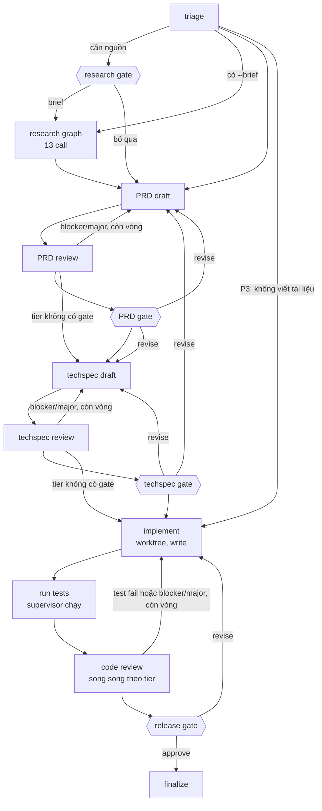

# Work flow (LangGraph)

`run_flow.py` điều phối một task làm việc từ yêu cầu đến nhánh code chờ duyệt.
`lab/flow/graph.py` định nghĩa đồ thị; `lab/flow/task.py` tạo, seal và chạy tiếp
task; `lab/flow/contracts.py` giữ schema và kiểm tra tất định; `lab/flow/workspace.py`
quản lý git worktree và chạy test; `lab/jobs.py` là ledger gọi model dùng chung
với research.



Mọi node gọi model đều có thể dừng ở **blocked gate**. Mọi gate đều có `reject`,
dẫn tới `finalize` với trạng thái `rejected`. Chạy
`.venv/bin/python run_flow.py graph` để xem sơ đồ sinh từ code.

## Vai trò theo rủi ro

Ba lớp cấu hình tách nhau:

- **`config/agents.local.json`:** đường dẫn CLI của máy.
- **`config/personas.json`:** persona, gồm runtime, model, effort mặc định, model đối chứng (`challenger`) và các trường prompt.
- **`config/flow.json` → `roles`:** bước nào ở mức rủi ro nào dùng persona nào.

Một mục trong `roles` có thể là tên persona, hoặc dạng `{"persona", "model", "effort"}`
để đổi model hay effort riêng cho bước đó. Dạng thứ hai không được đổi runtime.

| Tier | Ví dụ | Tài liệu | Gate | Implement | Code review |
| --- | --- | --- | --- | --- | --- |
| P0 | tiền, idempotency, quyền, cách ly merchant | PRD + techspec | PRD, techspec, release | engineer (Codex Sol high) | code-reviewer (Opus high) + critical-invariants-reviewer (Opus xhigh) + adversarial-qa (Antigravity) |
| P1 | deploy, migration, tích hợp | PRD + techspec | PRD, techspec, release | engineer (Sol high) | code-reviewer (Opus high) + adversarial-qa |
| P2 | danh sách, bộ lọc, dashboard | PRD + techspec | techspec, release | engineer (Sol medium) | code-reviewer (Sonnet high) |
| P3 | demo, thử nghiệm | không | release | engineer (Sol medium) | code-reviewer (Sonnet high) |

Các bước còn lại:

- **Triage:** triage-lead (Codex Sol medium).
- **PRD:** product-manager (Codex Sol high) viết, requirements-reviewer (Claude Sonnet high) review.
- **Techspec:** engineer (Sol high) viết, architecture-reviewer (Claude Opus high) review.

`check_roster` từ chối các cấu hình sau:

- reviewer dùng cùng runtime với tác giả;
- vai ghi code dùng Antigravity;
- tier thiếu release gate;
- ghi đè sai khóa hoặc sai effort.

### Danh sách persona

Persona được chắt lọc từ BMAD-METHOD, agency-agents và wshobson/agents. Danh sách đã
được Claude và Codex (GPT-6 Astra) phản biện qua hai vòng. Mọi model trong danh sách
đã được gọi thử trên tài khoản này. Model đối chứng chỉ dùng khi so sánh, flow không
gọi nó.

| Persona | Dùng ở | Runtime / model / effort | Đối chứng |
| --- | --- | --- | --- |
| triage-lead | triage | Codex gpt-6.1-sol medium | gpt-6-luna high |
| product-manager | viết PRD | Codex gpt-6.1-sol high | gpt-6.1-terra high |
| requirements-reviewer | review PRD | Claude sonnet-5-5 high | opus-5-5 high |
| engineer | techspec, implement | Codex gpt-6.1-sol medium (high qua `roles`) | gpt-6.1-terra medium |
| architecture-reviewer | review techspec | Claude opus-5-5 high | sonnet-5-5 high |
| code-reviewer | review code | Claude sonnet-5-5 high (opus ở P0/P1) | opus-5-5 high |
| critical-invariants-reviewer | review code P0 | Claude opus-5-5 xhigh | fable-5-1 high |
| adversarial-qa | review code P0/P1 | Antigravity gemini-3.8-flash-high | claude-opus-4-6-thinking |
| technical-writer | docs (chưa nối) | Codex gpt-6.1-terra medium | gpt-6.1-sol medium |
| docs-verifier | docs (chưa nối) | Claude sonnet-5-5 high | opus-5-5 high |
| copywriter | content (chưa nối) | Codex gpt-6.1-terra medium | gpt-6.1-sol medium |
| content-editor | content (chưa nối) | Claude sonnet-5-5 medium | opus-5-5 medium |
| ux-designer | design (chưa nối) | Codex gpt-6.1-terra high | gpt-6.1-sol high |
| ui-reviewer | design (chưa nối) | Claude opus-5-5 high | Antigravity gemini-3.8-flash-high |

Các persona ghi "chưa nối" đã đăng ký nhưng chưa được bước nào dùng, cho tới khi flow
có `--kind`. Hai vai docs-verifier và ui-reviewer còn cần thêm bằng chứng từ supervisor
mới làm đủ việc: ví dụ trong docs đã chạy thật, ảnh chụp giao diện đã render. Khi chưa
có bằng chứng đó, kết luận của chúng phải ghi `unverified`.

Effort cùng tên không tương đương giữa các model: medium của Opus khác medium của Sonnet.
Codex CLI mặc định effort `low` cho Sol, Astra và Terra, nên persona nào cũng ghi effort
rõ ràng.

Mức rủi ro hiệu lực là mức nghiêm trọng hơn giữa `--risk` (mặc định
`default_risk` = P1) và đề xuất của triage. Model chỉ được nâng, không được hạ.
Người duyệt có thể đổi mức rủi ro ở bất kỳ gate nào bằng `--risk`; thay đổi áp
dụng cho các bước sau, không chạy lại các gate đã qua.

## Bất biến

- **LangGraph điều phối, ledger giữ tiền.** LangGraph chạy lại cả node sau crash,
  sau lỗi của nhánh song song và khi resume một `interrupt()`. Job ID và packet là
  hàm thuần của state (`prd-draft-2`, `code-review-code-reviewer-1`...), nên node chạy lại sẽ
  dùng lại job đã xong sau khi kiểm hash, không gọi model lần hai.
- **Code quyết định đường đi.** Vòng sửa dựa trên finding blocker/major, kết quả
  test do supervisor tự chạy và giới hạn vòng. Verdict của model không tự định tuyến.
  Báo cáo implement (`commands_run`, `summary`) được đưa cho reviewer dưới tên
  `implementation_claims`, không phải bằng chứng. Hết vòng mà PRD/techspec còn
  blocker/major thì luôn dừng ở gate của tài liệu đó, kể cả khi tier không có gate ấy.
- **Research là một lần chạy độc lập.** Node `research` gọi research graph trong
  context rỗng và không có checkpoint, nên mỗi lần chạy lại đều đi qua ledger và
  kiểm hash của research, không phát lại state cũ của LangGraph.
- **Kiểm tra tất định.** Lỗi cứng (ID trùng, tham chiếu không tồn tại, finding chưa
  được xử lý đúng một lần, file không có trong repo) làm output bị loại. Lỗi mềm
  (requirement *must* thiếu AC, AC không có test plan, file khai đã sửa nhưng diff
  không có, vòng implement không tạo thay đổi) thành finding `supervisor/...` để
  reviewer và người duyệt thấy.
- **Người là finding cấp cao nhất.** `revise --note` tạo finding `human/D<n>` mức
  blocker; vòng sau phải trả resolution cho đúng ID đó. Note khi `approve` trở thành
  `human_guidance` cho các bước sau.
- **Không tự retry.** Job lỗi, timeout, bị hủy hoặc chạm giới hạn lượt gọi sẽ dừng
  ở blocked gate. `retry` chỉ cho phép đúng **một** attempt kế tiếp của job đó (gắn
  với số attempt lúc quyết định); attempt cũ được lưu trong `attempts/`.
- **Không merge, push hay deploy.** Agent sửa code trong `tasks/<id>/worktree` trên
  nhánh `flow/<id>`. Supervisor commit từng vòng với trailer `Flow-Task`, `Flow-Job`,
  `Flow-Persona`, `Flow-Runtime`. Mọi tier đều kết thúc ở release gate; merge là
  việc của người.
- **Seal.** Request, roster, policy, protocol, skill, rule và cấu hình agent được snapshot
  và hash lúc tạo task. Task chờ nhiều ngày vẫn chạy với đúng đầu vào cũ. Phiên bản
  CLI thay đổi chỉ được ghi vào `versions-history.json` và cảnh báo, không chặn.

## Rule

Mọi packet có mục `# Rules (binding)` chứa nguyên văn các rule:

1. Rule chung: `rules/*.md` của repo này, trừ README.md.
2. Rule dự án: `AGENTS.md`, `CLAUDE.md` ở gốc repo đích, và các file truyền bằng
   `--rules`. Các file này được đọc từ commit gốc (`base_sha`), nên agent sửa chúng
   trong worktree cũng không làm đổi rule của task.

Rule đứng trên skill, nhưng không đổi được quyền, protocol hay schema. Reviewer
code và techspec kiểm theo rule. Vi phạm rule thành finding `rule-violation`. Rule
viết dạng *must*/*never* được tính ít nhất `major`, nên vi phạm sẽ kéo thêm vòng sửa.

## Skill

Skill nằm trong mục `# Skill guidance` của packet, xếp sau rule, và đến từ hai nơi:

- **`config/flow.json` → `skills`:** skill chung được gán cho từng bước, áp dụng ở mọi task.
- **`--skill <tên>`:** áp dụng cho techspec, techspec review, implement, code review và QA
  của task đó. Flow tìm skill theo thứ tự: `.agents/skills/` rồi `.claude/skills/` của repo
  đích (đọc từ commit gốc), sau đó tới skill chung trong lab. Một skill chung đã được gán
  cho bước nào thì không bị nhúng lại lần hai ở bước đó.

Flow nhúng `SKILL.md` và các file Markdown khác của skill. Mỗi skill hay file rule tối đa
200 KB.

**Script.** Bước `implement` được chạy các file `.py`, `.sh`, `.js` nằm ngay trong
`scripts/` của skill dự án. Mỗi file chỉ chạy đúng dạng `python3|bash|node <đường dẫn>`
cộng tham số. Packet liệt kê các lệnh này. Claude nhận chúng dưới dạng `Bash(<lệnh>)` và
`Bash(<lệnh> *)` trong allowlist. Codex chạy chúng trong sandbox `workspace-write`, không
có mạng.

Allowlist chỉ giới hạn lệnh mà agent được gọi, không giới hạn những gì code đó làm.
Script là code của repo, và implementer sửa được code repo. Mức tin cậy ở đây giống với
lệnh test, vốn cũng chạy code do agent viết. Skill chung trong lab thường lấy từ bên
ngoài, nên script của nó không bao giờ được chạy.

Reviewer không chạy script, và kết quả script do implementer báo lại chỉ là lời khai.
Muốn script thành bằng chứng thì đưa nó vào `--test`.

## Quyền theo chế độ

| Chế độ | Dùng cho | Codex | Claude Code | Antigravity |
| --- | --- | --- | --- | --- |
| `packet` | research | read-only, cấm lệnh | chỉ `Read` | plan + policy deny |
| `read` | triage, PRD, techspec, mọi review | read-only sandbox, cwd = worktree | `Read,Grep,Glob` | plan + policy deny |
| `write` | implement | `workspace-write` | `Read,Grep,Glob,Edit,Write` + Bash chỉ `git diff`, `git status`, lệnh test | không hỗ trợ |

Worker không tự đọc `AGENTS.md`/`CLAUDE.md` từ đĩa. Rule chỉ tới worker qua packet
đã seal, nên worker không đọc nhầm file viết cho AI vận hành của repo này, cũng không
đọc bản rule mà implementer đã sửa trong worktree. Claude dùng `--setting-sources ""`;
Codex dùng `-c project_doc_max_bytes=0` ở mọi chế độ. Cả hai đã được kiểm với CLI thật.
Antigravity không có cờ tắt. Ở chế độ `packet`, dòng đầu `AGENTS.md` bảo worker bỏ qua
file. Ở chế độ `read`, nó vẫn đọc `AGENTS.md` trong worktree.

Ở chế độ `write`, permission denial được ghi vào manifest và đưa lên reviewer cùng
release gate, không làm hỏng job. Supervisor tự chạy test nên lệnh bị chặn không
thể giả là đã đạt. Thư mục riêng và permission của CLI chưa phải cách ly hệ điều
hành; chạy test của repo đích nghĩa là chạy code do agent viết trên máy này.

## Thư mục task

```text
tasks/<task-id>/
  task.json, seal.json, snapshots/   đầu vào đã khóa
  checkpoints.db                     state LangGraph (thread_id = task id)
  state.db, jobs/, attempts/         ledger, packet, raw log, manifest từng job
  worktree/                          git worktree, nhánh flow/<task-id>
  docs/prd.md, docs/techspec.md      bản render mới nhất (+ prd-rN.md theo vòng)
  gates/*.md                         tóm tắt cho người duyệt và lệnh trả lời
  tests/round-N.{log,json}           kết quả test do supervisor chạy
  research/                          run research khi có brief
  report.md
```

Sau khi xong task: `git -C <repo> worktree remove tasks/<id>/worktree`. Nhánh
`flow/<id>` vẫn giữ trong repo đích cho tới khi bạn merge hoặc xóa.

## Giới hạn hiện tại

- Antigravity chưa nhận vai ghi code: cờ `--mode accept-edits`/`--sandbox` có
  trong CLI nhưng chưa được kiểm chứng cách chúng chặn quyền.
- Code review song song chạy tối đa 3 CLI cùng lúc ở P0. Research vẫn giữ audit
  và review tuần tự để không tăng số tiến trình đồng thời.
- Diff đưa cho reviewer bị cắt ở `diff_limit_bytes`; reviewer vẫn đọc được toàn
  bộ worktree.
- Giới hạn lượt gọi tính riêng cho flow (mặc định 40) và cho research (13). Đây
  không phải hard cap tiền.
