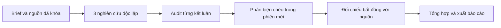

# Research pipeline

`run_lab.py` nghiên cứu một câu hỏi trên **packet nguồn đã khóa**: ba AI làm bài
độc lập, mỗi bài được audit với nguồn, phản biện ẩn danh, rồi tác giả đối chiếu
lại trong phiên mới. Một lượt đầy đủ có **13 model call** (3 research, 3 audit,
3 review, 3 adjudication, 1 synthesis). Pipeline không tự duyệt web và không chạy
thí nghiệm mà báo cáo đề xuất. Work flow (`run_flow.py`) gọi pipeline này khi
task cần research; xem [flow.md](flow.md).



## Chạy

```bash
.venv/bin/python run_lab.py --check                  # kiểm cấu hình + version CLI, không gọi model
.venv/bin/python run_lab.py --demo                   # CLI giả lập, không tốn quota
.venv/bin/python run_lab.py --brief path/brief.md --timeout 900
.venv/bin/python run_lab.py --brief path/brief.md --research-skill <skill>   # lặp được
```

Kết quả: `runs/<run-id>/final-report.md`. Đường dẫn `--brief` tính từ thư mục
gốc của repo. Mẫu brief: [inputs/brief.md](../inputs/brief.md).

**Brief** cần câu hỏi, phạm vi và các mục `Source <ID>` độc nhất. Ghi URL,
commit/phiên bản, thời điểm thu thập và phần lược bỏ trong từng nguồn. Pipeline
khóa nội dung được cấp, không giả nhận đó là nguồn vừa tải trực tiếp. `verified`
nghĩa là AI đã đối chiếu với packet, chưa phải người kiểm chứng.

## Resume, lỗi và giới hạn

```bash
.venv/bin/python run_lab.py --resume runs/<run-id> --check         # kiểm snapshot + version
.venv/bin/python run_lab.py --resume runs/<run-id>                 # chạy job còn thiếu, dùng lại job đã xong
.venv/bin/python run_lab.py --resume runs/<run-id> --revalidate    # parse lại output đã lưu sau khi sửa parser
.venv/bin/python run_lab.py --resume runs/<run-id> --retry-failed --max-calls 14   # sau khi đã xem log lỗi
```

- Không tự retry job lỗi; `--retry-failed` là quyết định của người vận hành,
  attempt cũ giữ trong `attempts/`. Không retry khi process group cũ còn sống.
- Mặc định tối đa 13 lượt bắt đầu, tính cả lượt lỗi; timeout mặc định 600 giây/job;
  output tối đa 8 MiB/stream. Đây không phải hard cap tiền; chi phí chưa biết giữ `null`.
- Worker lỗi không làm mất kết quả của worker khác; run kết thúc `complete_with_gaps`.
  Synthesis chỉ chạy khi đủ coverage. Exit `0` đủ bước, `1` lỗi/thiếu coverage, `130` bị hủy.
- Resume dùng snapshot cũ và cùng version CLI. Đổi brief/rubric/skill thì tạo run mới.

## Artifact

| Artifact | Nội dung |
| --- | --- |
| `final-report.md` | Tổng hợp, khuyến nghị, Verified / Disputed / Inconclusive |
| `verification.json` | Mỗi kết luận, excerpt, hash nguồn/báo cáo, `human_reviewed: false` |
| `summary.json` | Coverage, số call/attempt, usage và chi phí quan sát được |
| `assignments.json` | Mapping tác giả, auditor, reviewer, adjudicator |
| `snapshots/` + `seal.json` | Brief, nguồn, schema, policy, protocol, skill, model, version đã khóa |
| `jobs/<stage>-<alias>/<worker>/` | Packet, raw log, manifest và output có schema |
| `state.db` | Ledger job (SQLite) |

## Skills

Skill là tài liệu hướng dẫn được **nhúng vào packet**, nên cả ba CLI nhận cùng
nội dung. Mỗi skill trong `.agents/skills/` có một mục trong `config/skills.lock.json`
ghi nguồn (repository, commit) và hash từng file; flow kiểm hash trước khi gọi model.
Script đi kèm skill trong lab không bao giờ được chạy.

Skill **gắn cố định** được nhúng vào mọi lượt gọi của bước đó. Skill **theo task** chỉ được
nhúng khi AI điều phối chọn bằng `--skill`. Cột KB là kích thước được nhúng vào mỗi lượt gọi.

| Skill | KB | Dùng ở | Nguồn |
| --- | --- | --- | --- |
| `multi-reviewer-patterns` | 9 | gắn cố định: review và adjudication của research | wshobson/agents |
| `code-review-excellence` | 13 | gắn cố định: code review | wshobson/agents |
| `avoid-ai-writing` | 43 | gắn cố định: viết và soát content | wshobson/agents (tác giả Conor Bronsdon) |
| `wcag-audit-patterns` | 12 | gắn cố định: review đặc tả UX và review UI | wshobson/agents |
| `change-verification` | 9 | theo task: sửa bug, thay đổi đụng tiền, quyền, dữ liệu | ai-guardrails v1.5 |
| `decision-review` | 5 | theo task: quyết định thiết kế, UX, API, phân quyền còn mở | ai-guardrails v1.5 |
| `visual-consistency-review` | 3 | theo task: output là ảnh, sprite, animation | ai-guardrails v1.5 |
| `debugging-strategies` | 12 | theo task: sửa bug, tìm nguyên nhân gốc | wshobson/agents |
| `api-design-principles` | 29 | theo task: thiết kế hoặc đổi API | wshobson/agents |
| `openapi-spec-generation` | 25 | theo task: docs API, OpenAPI | wshobson/agents |
| `database-migration` | 9 | theo task: migration dữ liệu | wshobson/agents |
| `stride-analysis-patterns` | 20 | theo task: thay đổi về bảo mật, phân quyền (P0) | wshobson/agents |
| `interaction-design` | 40 | theo task, loại `design`: tương tác, chuyển động | wshobson/agents |
| `responsive-design` | 43 | theo task, loại `design`: layout trên nhiều cỡ màn hình | wshobson/agents |

License và tác giả: `third_party/NOTICE.md`.

Thêm skill: chép thư mục skill vào `.agents/skills/<name>/`, rồi ghi nguồn và hash vào lock:

```bash
.venv/bin/python - <name> <repository> <commit> <đường-dẫn-trong-repo-nguồn> <<'PY'
import hashlib, json, sys
from pathlib import Path
name, repository, commit, path = sys.argv[1:5]
folder, lock_path = Path(".agents/skills") / name, Path("config/skills.lock.json")
lock = json.loads(lock_path.read_text())
files = {str(p.relative_to(folder)): hashlib.sha256(p.read_bytes()).hexdigest()
         for p in sorted(folder.rglob("*")) if p.is_file()}
entry = {"name": name, "repository": repository, "commit": commit, "path": path, "files": files}
lock["skills"] = [s for s in lock["skills"] if s["name"] != name] + [entry]
lock_path.write_text(json.dumps(lock, ensure_ascii=False, indent=2) + "\n")
PY
```

## Kiến trúc

`lab/runtime.py` gọi CLI, kiểm provider và dừng process group; `lab/contracts.py`
định nghĩa schema và kiểm excerpt; `lab/state.py` lưu SQLite; `lab/jobs.py` giữ
ledger job (reuse, retry, giới hạn lượt gọi) dùng chung với work flow;
`lab/pipeline.py` khai báo thứ tự bước bằng LangGraph `StateGraph` và render báo
cáo. Research không dùng checkpoint của LangGraph: resume gọi lại graph và ledger
dùng lại mọi job đã hoàn tất.

### Vai trò và thứ tự

| Bước | Job | Nhiệm vụ |
| --- | --- | --- |
| Research | A / Codex, B / Claude, C / Antigravity | Cùng packet, chưa nhận bài của nhau |
| Audit | A / Claude, B / Antigravity, C / Codex | Đối chiếu từng claim, summary và limitations |
| Review | A / Antigravity, B / Codex, C / Claude | Tìm phản bác, không thấy audit |
| Adjudication | A / Codex, B / Claude, C / Antigravity | Phiên mới đối chiếu audit và mọi finding với nguồn |
| Synthesis | Codex | Tổng hợp có claim refs; code giữ quyền phân loại |

Có barrier giữa các bước. Một report lỗi không làm mất kết quả của các report
khác. Chỉ report đủ audit và review được adjudicate. Synthesis chỉ chạy khi đủ
coverage, không còn blocker; code vẫn render báo cáo thiếu coverage.

### Hợp đồng nội dung

- Research: claim ID độc nhất, nội dung không rỗng, source IDs tồn tại trong brief.
- Audit/adjudication: phủ đúng mỗi claim cộng summary/limitations một lần.
  Supported/contradicted cần excerpt xuất hiện nguyên văn trong nguồn đã khóa.
  Code kiểm provenance, không chứng minh diễn giải của model là đúng.
  Cho phép khác biệt chỉ về khoảng trắng khi tìm excerpt; output chuẩn hóa
  lưu lại đúng span gốc, stdout/final.json giữ nguyên câu model đã trả.
- Review: khai đủ mọi target đã kiểm, finding ID độc nhất, target có thật;
  contradiction cần excerpt; thiếu chứng cứ không được bịa excerpt.
- Adjudication: giải quyết mỗi finding một lần. Bác finding cần nguồn; nhận
  phản bác major không được giữ target supported.
- Synthesis: khuyến nghị dẫn claim ref có thật. Code render bảng bằng chứng
  riêng; synthesis không được thay nhãn xác minh.
- Supported qua đủ bước và không còn bất đồng là verified trong phạm vi AI/
  packet. Contradicted hoặc finding chưa giải quyết là disputed; thiếu coverage/
  bằng chứng là inconclusive. Auditor contradicted mà tác giả đảo thành supported
  vẫn là disputed, cần quyết định độc lập.
- Không tự thực thi thí nghiệm/benchmark. Bằng chứng evaluator chỉ có giá trị
  khi được cấp thành nguồn, kèm artifact và phạm vi kiểm rõ ràng.

### Snapshot, state và resume

Prepare đọc brief, schema, policy, rubric, protocol và skill trước version check;
snapshot giữ nội dung đã đọc. `seal.json` giữ hash. Source được tách theo dòng
`Source <ID>`; ID trùng bị từ chối. Index ghi `origin: supplied_packet`, không
bịa URL/ngày thu thập. Chỉ skill được chọn và Markdown reference mới vào packet.

Mỗi run dùng flock độc quyền trên Linux. State: pending → running (tăng attempts)
→ collected_unverified / failed / interrupted. Commit trước spawn, ghi PID khi
spawn xong, commit sau từng worker. Resume kiểm snapshot, version, manifest/state,
input/output hash, schema và coverage trước reuse. Manifest thành công còn
nguyên mà SQLite vẫn running được phục hồi không gọi model.

Failed/interrupted/running chưa có kết quả hoàn tất cần `--retry-failed`; không
retry nếu process group cũ còn sống. Call limit tính cả lần đã chuyển running
nhưng chưa chắc spawn thành công. Điều này có thể đếm dư sau crash, tránh âm
thầm dùng thêm quota. Retry giữ attempt cũ. Output hoàn tất bị thay đổi làm
resume dừng, không tự tạo inference thay thế.

`--revalidate` parse lại raw output của job failed có exit 0, đúng input hash,
không còn process và không có lỗi cleanup. Vẫn áp provider/schema/coverage/
source/permission checks. Chỉ khi vượt hết mới lưu manifest chuẩn hóa mới,
giữ manifest lỗi cũ trong `revalidations/`; không tăng attempts hoặc gọi model
cho job đó. Các job pending phía sau tiếp tục như resume thông thường.

JSON được thay bằng rename để tránh đọc file ghi dở; SQLite có transaction.
Hash phát hiện thay đổi với baseline hiện có, không phải chữ ký chống người có
quyền ghi cả baseline. Không cam kết durability khi mất nguồn điện hoặc
exactly-once phía provider. Khoảng spawn → ghi PID sau kill cứng cần người
vận hành kiểm tiến trình/provider trước retry.

### Quyền và giới hạn

CLI nhận packet qua stdin để tránh giới hạn argv Linux: Codex stdin prompt,
Claude piped input, Antigravity một user event stream-json rồi đóng stdin.
Chỉ chấp nhận một native result của Antigravity mỗi job.

Codex read-only/approval never, Claude Read/dontAsk/empty MCP, Antigravity deny
write/command/URL/MCP. Cho phép native structured result submission; không bypass
quyền và không tiếp tục hội thoại cũ. Tách cwd và giữ mapping ở supervisor chưa
phải cách ly OS; runtime global state vẫn có thể ảnh hưởng kết quả.

Cost chưa quan sát là null. `known_cost_usd` cộng giá trị được báo ở attempt
hiện tại; khi retry, nó không đại diện tổng bill. Tổng cost chỉ có khi mọi job
báo cost và không có retry; xem `attempts/` cho lịch sử. Requested model/effort
không chứng minh effective model/effort; trường chưa xác nhận giữ null.
